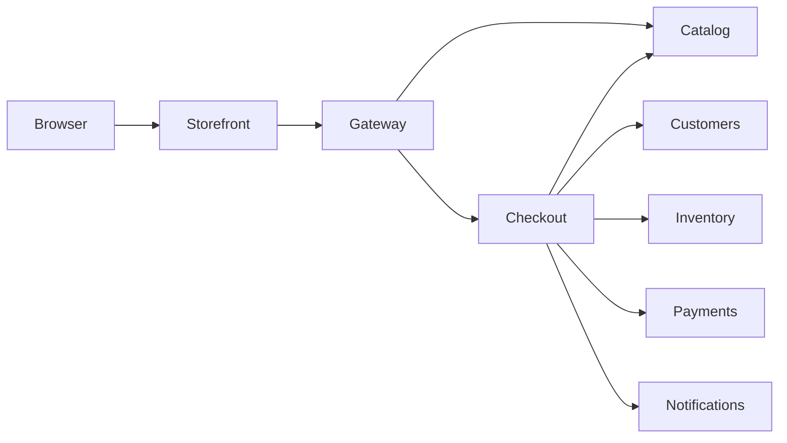

# Harbour Commerce Demo

A fictional ecommerce company with eight small, working services across nine private repositories. Browse products, create a basket, reserve stock, simulate payment, and inspect the confirmation. No cloud infrastructure, real payments, or email account is required.

## Start locally

Requirements: GitHub CLI authenticated with access to this organization, Docker with Compose v2, and Node.js 22+ for the smoke test.

```sh
gh repo clone Harbour-Commerce-Demo/platform-infra
cd platform-infra
./scripts/bootstrap.sh
docker compose up --build -d --wait
node scripts/smoke.mjs
```

Open **http://localhost:3000**. The API gateway is **http://localhost:8080**. Both bind only to localhost; the other six services are private to the Compose network. If a port is occupied, copy `.env.example` to `.env` and change it. For a changed API port, run `GATEWAY_URL=http://127.0.0.1:YOUR_PORT node scripts/smoke.mjs`.

The checkout scripts sit alongside the service repositories:

```text
demo/
  platform-infra/
  checkout-service/
  api-gateway/
  user-management/
  product-catalog/
  inventory-service/
  payment-service/
  notification-service/
  storefront/
```

## Repositories

| Repository | Language | Role |
| --- | --- | --- |
| [checkout-service](https://github.com/Harbour-Commerce-Demo/checkout-service) | Go | Prices and orchestrates orders; compensates declined payments |
| [api-gateway](https://github.com/Harbour-Commerce-Demo/api-gateway) | TypeScript / Node | Routes `/api/*` requests |
| [user-management](https://github.com/Harbour-Commerce-Demo/user-management) | Go | Customer profiles |
| [product-catalog](https://github.com/Harbour-Commerce-Demo/product-catalog) | TypeScript / Node | Products, search, categories, and prices |
| [inventory-service](https://github.com/Harbour-Commerce-Demo/inventory-service) | Go | Atomic stock reservations |
| [payment-service](https://github.com/Harbour-Commerce-Demo/payment-service) | Go | Simulated payments |
| [notification-service](https://github.com/Harbour-Commerce-Demo/notification-service) | TypeScript / Node | Confirmation outbox |
| [storefront](https://github.com/Harbour-Commerce-Demo/storefront) | TypeScript / Node | Browser shop and same-origin API proxy |
| platform-infra | YAML / shell / JavaScript | Compose and end-to-end smoke test |



## A five-minute demo

1. Open the storefront and add a mug and notebook to the basket.
2. Choose Alex Morgan and the approved payment scenario. Place the order.
3. Inspect the returned order, payment, and confirmation through the gateway.
4. Try the declined scenario. Stock is released and the basket remains available.
5. Open a service repository's Actions tab: tests, downloadable build archive, and Docker publication are visible. Open its Packages link for the container image.

```sh
curl http://localhost:8080/api/products
curl http://localhost:8080/api/inventory
curl http://localhost:8080/api/notifications
docker compose logs --tail=30 checkout-service
docker compose down
```

`node scripts/smoke.mjs` places one real demo order, checks retries do not charge or reserve twice, checks a declined payment restores stock, and rejects invalid baskets. It consumes two mugs and one notebook each run. Restart the whole stack for fresh fixtures:

```sh
docker compose down
docker compose up -d --wait
```

## Images and workflow artifacts

Each application repository has an Actions workflow that tests code, uploads a build archive (14-day retention), builds a Docker image, and publishes to `ghcr.io/harbour-commerce-demo/<repo>`. Main publishes `latest`; commit builds use `sha-<full-commit>` and `v*` tags are also published. Pull requests build without publishing. The infrastructure workflow validates Compose and scripts and uploads a deployment bundle.

To use published images instead of building locally, authenticate Docker to GHCR with a token that has `read:packages` and organization access, then:

```sh
docker compose pull
docker compose up --no-build -d --wait
```

Private package publishing uses each workflow's `GITHUB_TOKEN` with `packages: write`. No custom secrets are needed. Organization Actions/package policy must permit it. For reproducible demos, pin each Compose image to its service's `sha-...` tag or digest instead of `latest`.

## Deliberate limits

- In-memory stores, seeded with fictional data; state resets on service restart.
- No login, authentication, message broker, or external database. Keep this stack local or on an isolated demo network.
- All money is GBP integer pence. Payment tokens are `tok_demo_visa` and `tok_demo_declined`; never supply real card details.
- Notification records stay local. No email is delivered.
- Checkout uses synchronous HTTP and in-memory idempotency. It is suitable for demonstration, not durable commerce: restarts and ambiguous upstream timeouts need production reconciliation and an outbox.
- No deployment to a cloud or Kubernetes cluster occurs. CI publishes private build artifacts and images only.
